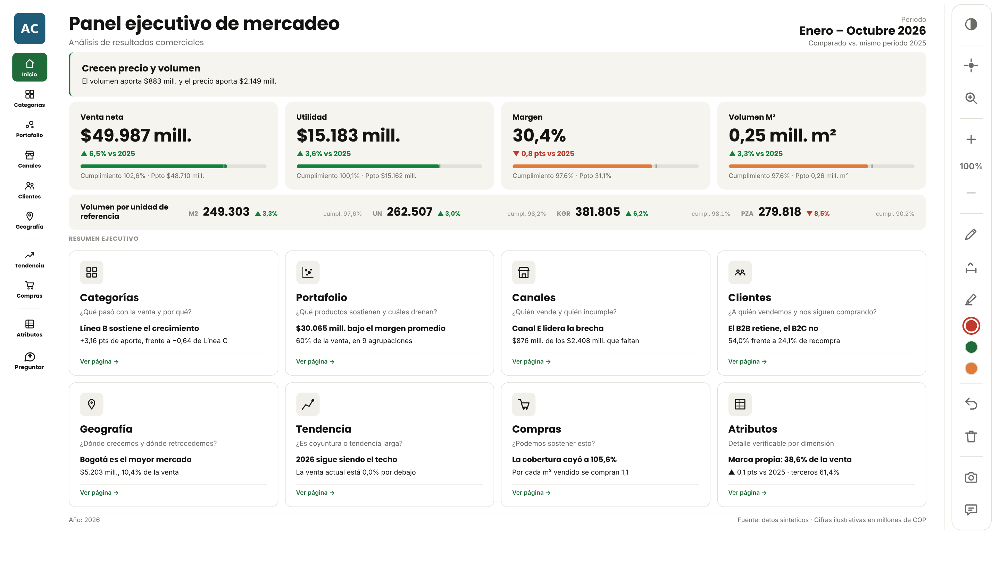
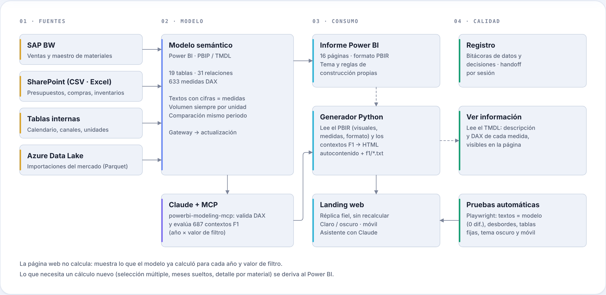
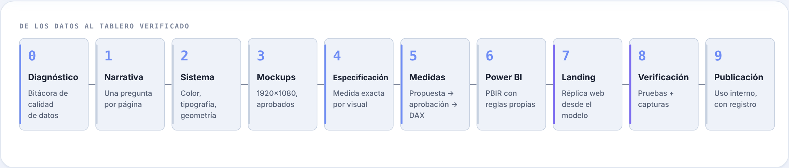
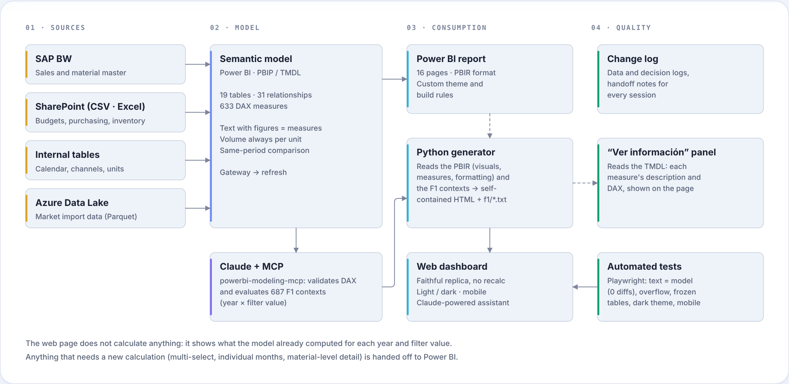
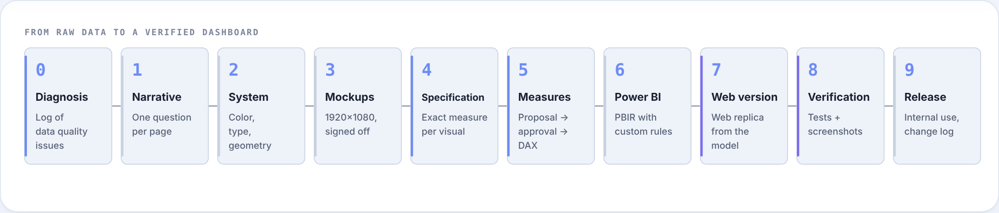

# Panel ejecutivo de mercadeo · Power BI + tablero web interactivo

**Español** · [English](#english)

Caso de negocio de **Juan David Cano**. Rediseño completo del análisis comercial de una empresa del sector de acabados para la construcción, con dos entregables sobre el mismo modelo:

1. **Informe de Power BI** de 16 páginas: conexiones en Power Query, modelo semántico de 19 tablas y 633 medidas DAX.
2. **Tablero web interactivo** de uso interno del equipo y la gerencia, que replica el informe en el navegador y se verifica automáticamente contra el modelo.

**En línea:** https://caso-panel-ejecutivo.vercel.app

> **Confidencialidad.** Las capturas del tablero se tomaron sobre una copia del modelo cargada con datos sintéticos: cifras y nombres comerciales (clientes, marcas, proveedores, canales, oficinas, líneas de producto, logotipo) son ficticios y no se derivan de los de la empresa. Las cifras de construcción del proyecto (páginas, tablas, relaciones, medidas, pruebas) son reales. El nombre de la empresa no se publica. Ver [`CONFIDENCIALIDAD.md`](CONFIDENCIALIDAD.md) y [`docs/06_anonimizacion.md`](docs/06_anonimizacion.md).

## En cifras

| | |
|---|---|
| Páginas del informe | 16 (formato PBIP / PBIR) |
| Objetos visuales | 1.888 |
| Tablas · relaciones | 19 · 31 |
| Medidas DAX | 633 (365 documentadas, 307 devuelven texto) |
| Orígenes | SAP BW, SharePoint (CSV y Excel), Azure Data Lake (Parquet), tablas internas |
| Contextos precalculados para la web | 687 (año × valor de filtro) |
| Diferencias web vs. modelo | 0 (prueba automática en las 16 vistas) |

## Cómo verlo

- **Informe del caso:** [`index.html`](index.html), una sola página con selector de idioma (ES/EN) y de tema (oscuro por defecto). También en PDF, en español: [`Caso_Panel_ejecutivo_mercadeo.pdf`](Caso_Panel_ejecutivo_mercadeo.pdf).
- **Imágenes:** [`imagenes/`](imagenes/) (vistas, tema oscuro, funciones, Power BI, diagramas).

## Arquitectura

## Documentación de la construcción

| Documento | Contenido |
|---|---|
| [`01_arquitectura_y_conexiones.md`](docs/01_arquitectura_y_conexiones.md) | Fuentes, conectores de Power Query, actualización y migración de origen |
| [`02_modelo_semantico.md`](docs/02_modelo_semantico.md) | Tablas, columnas, relaciones y reglas del modelo |
| [`03_medidas_dax.md`](docs/03_medidas_dax.md) | Inventario de las 633 medidas, convenciones y ejemplos de DAX |
| [`04_informe_powerbi.md`](docs/04_informe_powerbi.md) | Las 16 páginas, la narrativa y el sistema visual del informe |
| [`05_tablero_web.md`](docs/05_tablero_web.md) | Cómo se replica el informe en la web, funciones y pruebas |
| [`06_anonimizacion.md`](docs/06_anonimizacion.md) | Qué se cambió en las imágenes y cómo se verificó |

## Método

1. **Diagnóstico antes que diseño:** bitácora de calidad de datos (unidades mezcladas, campos sin asignar en el ERP, filtros que no propagaban).
2. **Una pregunta por página** y navegación narrativa: qué pasó → qué productos → quién vende → a quién → dónde → desde cuándo → ¿es sostenible?
3. **Mockups aprobados** a 1920 × 1080 antes de construir.
4. **Medidas propuestas, aprobadas y validadas** con DAX contra el modelo antes de usarlas.
5. **Construcción en PBIR** con reglas propias y **réplica web** desde el mismo modelo.
6. **Verificación automática** (cifras, desbordes, tema oscuro, celular) y revisión visual de capturas.

## Stack

Power BI Desktop (PBIP/PBIR, TMDL) · DAX · Power Query (M) · SAP BW · SharePoint · Azure Data Lake · Python · JavaScript/HTML/CSS · Playwright · Claude con servidor MCP de modelado de Power BI.

## Derechos

© 2026 Juan David Cano. Todos los derechos reservados (ver `LICENSE`).

Juan David Cano · [Portafolio](https://jdc-portafolio.vercel.app)

---

## English

Business case by **Juan David Cano**. A full redesign of the sales analytics of a company in the building finishes industry, with two deliverables built on the same model:

1. **A 16-page Power BI report:** Power Query connections, a semantic model with 19 tables and 633 DAX measures.
2. **An interactive web dashboard**, used internally by the team and management, that replicates the report in the browser and is automatically verified against the model.

**Live:** https://caso-panel-ejecutivo.vercel.app/?lang=en

> **Confidentiality.** The dashboard screenshots were taken on a copy of the model loaded with synthetic data: figures and commercial names (customers, brands, suppliers, channels, sales offices, product lines, logo) are fictitious and are not derived from the company's. The build figures (pages, tables, relationships, measures, tests) are real. The company name is withheld. See [`CONFIDENCIALIDAD.md`](CONFIDENCIALIDAD.md) and [`docs/06_anonimizacion.md`](docs/06_anonimizacion.md) (in Spanish).

The dashboard screenshots show the interface in Spanish, the report's original language.

### At a glance

| | |
|---|---|
| Report pages | 16 (PBIP / PBIR format) |
| Visual objects | 1,888 |
| Tables · relationships | 19 · 31 |
| DAX measures | 633 (365 documented, 307 return text) |
| Data sources | SAP BW, SharePoint (CSV and Excel), Azure Data Lake (Parquet), internal tables |
| Precomputed contexts for the web version | 687 (year × filter value) |
| Differences, web vs. model | 0 (automated test across all 16 views) |

### How to view it

- **Case study page:** [`index.html`](index.html), a single page with a language switch (ES/EN) and a theme switch (dark by default). Also available as a PDF, in Spanish: [`Caso_Panel_ejecutivo_mercadeo.pdf`](Caso_Panel_ejecutivo_mercadeo.pdf).
- **Images:** [`imagenes/`](imagenes/) (views, dark theme, features, Power BI, diagrams).

### Architecture

### Build documentation (in Spanish)

| Document | Contents |
|---|---|
| [`01_arquitectura_y_conexiones.md`](docs/01_arquitectura_y_conexiones.md) | Sources, Power Query connectors, refresh and source migration |
| [`02_modelo_semantico.md`](docs/02_modelo_semantico.md) | Model tables, columns, relationships and rules |
| [`03_medidas_dax.md`](docs/03_medidas_dax.md) | Inventory of the 633 measures, conventions and DAX examples |
| [`04_informe_powerbi.md`](docs/04_informe_powerbi.md) | The 16 pages, the narrative and the report's visual system |
| [`05_tablero_web.md`](docs/05_tablero_web.md) | How the report is replicated on the web, features and tests |
| [`06_anonimizacion.md`](docs/06_anonimizacion.md) | What was changed in the images and how it was verified |

### Method

1. **Diagnosis before design:** a data quality log (mixed units of measure, unassigned ERP fields, filters that did not propagate).
2. **One question per page** and a narrative flow: what happened → which products → who sells → to whom → where → since when → is it sustainable?
3. **Signed-off mockups** at 1920 × 1080 before building.
4. **Measures proposed, approved and validated** with DAX against the model before use.
5. **Built in PBIR** with custom rules, and a **web replica** generated from the same model.
6. **Automated verification** (figures, overflow, dark theme, mobile) plus a visual review of screenshots.

### Stack

Power BI Desktop (PBIP/PBIR, TMDL) · DAX · Power Query (M) · SAP BW · SharePoint · Azure Data Lake · Python · JavaScript/HTML/CSS · Playwright · Claude with the Power BI modeling MCP server.

### Rights

© 2026 Juan David Cano. All rights reserved (see `LICENSE`).

Juan David Cano · [Portfolio](https://jdc-portafolio.vercel.app)
