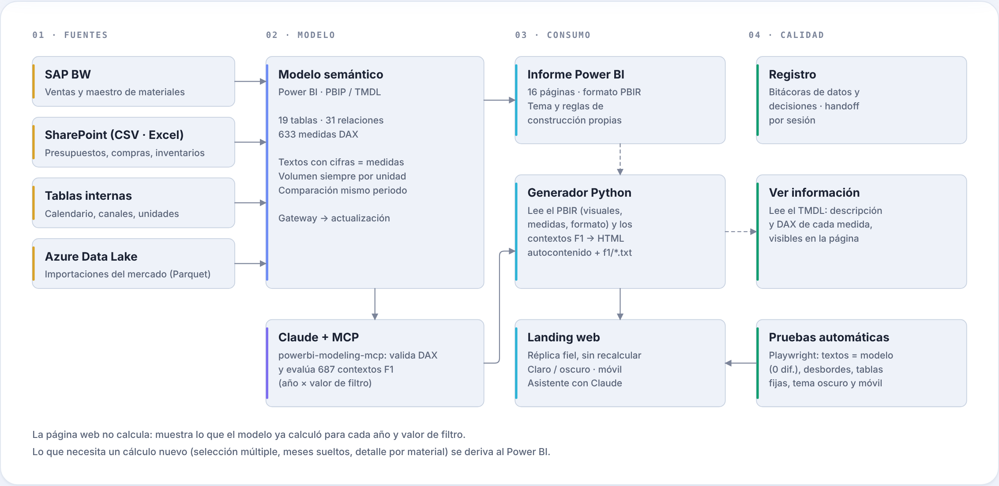
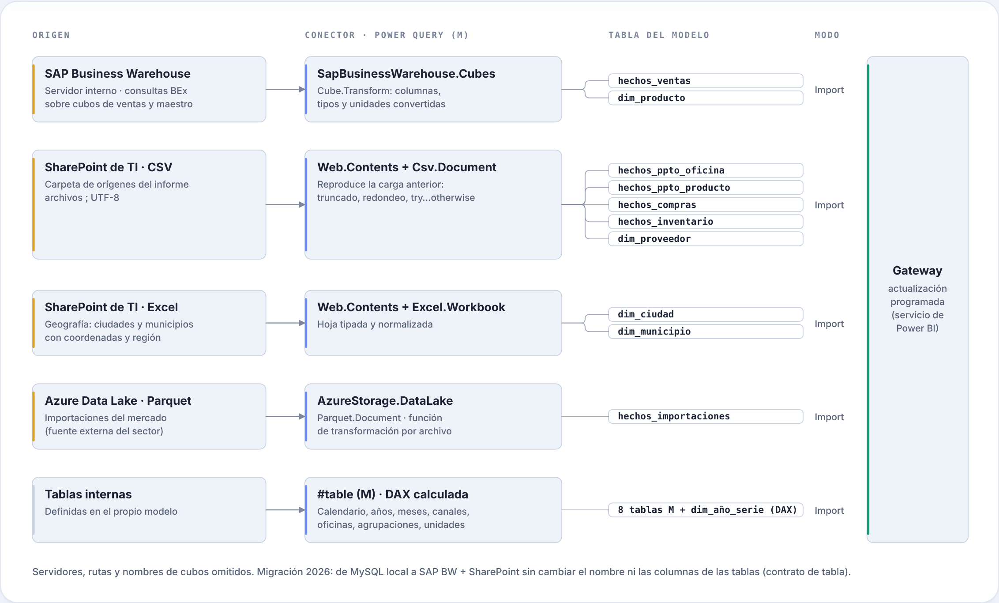

# 01 · Arquitectura y conexiones

## Conexiones de datos (Power Query)

| Origen | Conector (M) | Tablas | Notas |
|---|---|---|---|
| SAP Business Warehouse (servidor interno) | `SapBusinessWarehouse.Cubes` + `Cube.Transform` | `hechos_ventas`, `dim_producto` | Consultas BEx sobre el cubo de ventas y el maestro de materiales; columnas derivadas (conversión de unidades, canal ajustado) en M |
| SharePoint de TI · CSV | `Web.Contents` + `Csv.Document` | `hechos_ppto_oficina`, `hechos_ppto_producto`, `hechos_compras`, `hechos_inventario`, `dim_proveedor` | Separador `;`, UTF-8. Reproduce las reglas de la carga anterior (truncado, redondeo, `try … otherwise 0`) |
| SharePoint de TI · Excel | `Web.Contents` + `Excel.Workbook` | `dim_ciudad`, `dim_municipio` | Geografía con coordenadas y región |
| Azure Data Lake · Parquet | `AzureStorage.DataLake` + `Parquet.Document` | `hechos_importaciones` | Función de transformación por archivo |
| Tablas internas | `#table` en M · tabla calculada DAX | `dim_calendario`, `dim_año`, `dim_mes`, `dim_canal`, `dim_oficina`, `dim_agrupacion`, `dim_unidad`, `dim_actualizacion`, `dim_año_serie` | Dimensiones controladas por el equipo |

- **Modo:** Import en todas las tablas.
- **Actualización:** programada en el servicio de Power BI mediante gateway (publica TI).
- Servidores, rutas de archivos y nombres de cubos se omiten. Los nombres de tablas son genéricos (ver `02_modelo_semantico.md`).

## Migración de origen (2026)

Las ventas y los presupuestos venían de una base MySQL local. Se migraron a SAP BW (ventas, maestro) y a archivos en SharePoint (presupuestos, compras, inventarios) **sin cambiar el nombre, las columnas ni los tipos de las tablas** (contrato de tabla, R27). Antes de dar por bueno el cambio se compararon cifras de control entre el origen viejo y el nuevo y se revisaron los literales de texto de los que dependen las medidas.

## De dónde sale cada pieza

| Pieza | Fuente |
|---|---|
| Informe Power BI | Proyecto PBIP: `*.SemanticModel` (TMDL) + `*.Report` (PBIR) |
| Tablero web | Generador en Python que lee el PBIR (visuales, medidas, formato) y los contextos evaluados en el modelo |
| Contextos de la web | 687 evaluaciones (año × valor de filtro) hechas con un servidor MCP de modelado conectado a Power BI Desktop |
| «Ver información» en la web | Descripción y DAX de cada medida, leídos del TMDL |
