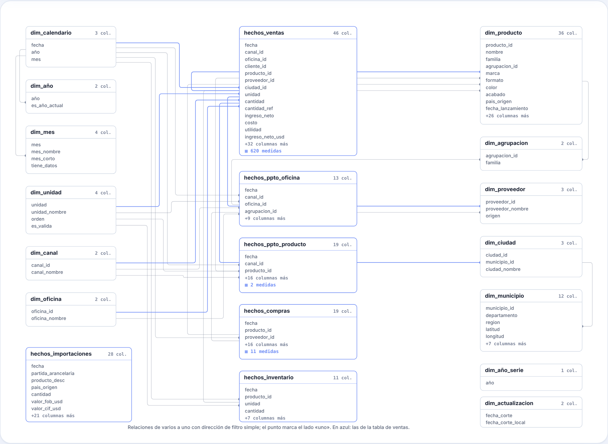

# 02 · Modelo semántico

> Generado desde el TMDL del proyecto (formato PBIP). **Por confidencialidad, los nombres de tablas y columnas son genéricos** y solo se publican las columnas representativas de cada tabla; los conteos (tablas, relaciones, columnas y medidas) son los reales.

| | |
|---|---|
| Tablas | 19 (más tablas de fecha automáticas) |
| Relaciones | 31 (26 entre tablas del modelo + 5 a tablas de fecha automáticas) |
| Medidas | 633 (620 en `hechos_ventas`, 11 en `hechos_compras`, 2 en `hechos_ppto_producto`) · 365 con descripción |
| Modo | Import en todas las tablas |
| Esquema | Estrella con varias tablas de hechos que comparten dimensiones (constelación) |

## Tablas

| Tabla | Rol | Columnas | Medidas |
|---|---|---|---|
| `hechos_ventas` | Hecho principal | 46 | 620 |
| `hechos_ppto_oficina` | Hecho · presupuesto por canal y oficina | 13 | — |
| `hechos_ppto_producto` | Hecho · presupuesto por producto y canal | 19 | 2 |
| `hechos_compras` | Hecho · compras en USD | 19 | 11 |
| `hechos_inventario` | Hecho · inventario por producto | 11 | — |
| `hechos_importaciones` | Hecho aislado · importaciones del mercado | 28 | — |
| `dim_producto` | Dimensión | 36 | — |
| `dim_agrupacion` | Dimensión | 2 | — |
| `dim_canal` | Dimensión | 2 | — |
| `dim_oficina` | Dimensión | 2 | — |
| `dim_unidad` | Dimensión | 4 | — |
| `dim_proveedor` | Dimensión | 3 | — |
| `dim_ciudad` | Dimensión | 3 | — |
| `dim_municipio` | Dimensión | 12 | — |
| `dim_calendario` | Dimensión | 3 | — |
| `dim_año` | Dimensión | 2 | — |
| `dim_mes` | Dimensión | 4 | — |
| `dim_año_serie` | Dimensión | 1 | — |
| `dim_actualizacion` | Dimensión | 2 | — |

## Relaciones

Todas son de varios a uno, activas y con dirección de filtro simple.

| Desde (*) | Hacia (1) |
|---|---|
| `hechos_ppto_oficina[canal_id]` | `dim_canal[canal_id]` |
| `hechos_ppto_oficina[oficina_id]` | `dim_oficina[oficina_id]` |
| `hechos_ppto_oficina[agrupacion_id]` | `dim_agrupacion[agrupacion_id]` |
| `hechos_ventas[unidad]` | `dim_unidad[unidad]` |
| `hechos_ppto_producto[unidad]` | `dim_unidad[unidad]` |
| `hechos_inventario[unidad]` | `dim_unidad[unidad]` |
| `hechos_ppto_oficina[unidad]` | `dim_unidad[unidad]` |
| `hechos_ventas[proveedor_id]` | `dim_proveedor[proveedor_id]` |
| `hechos_ventas[canal_id]` | `dim_canal[canal_id]` |
| `hechos_ventas[oficina_id]` | `dim_oficina[oficina_id]` |
| `hechos_ventas[fecha]` | `dim_calendario[fecha]` |
| `dim_calendario[año]` | `dim_año[año]` |
| `dim_calendario[mes]` | `dim_mes[mes]` |
| `hechos_ppto_oficina[fecha]` | `dim_calendario[fecha]` |
| `hechos_ppto_producto[fecha]` | `dim_calendario[fecha]` |
| `hechos_inventario[fecha]` | `dim_calendario[fecha]` |
| `hechos_compras[proveedor_id]` | `dim_proveedor[proveedor_id]` |
| `hechos_compras[fecha]` | `dim_calendario[fecha]` |
| `hechos_ppto_producto[canal_id]` | `dim_canal[canal_id]` |
| `hechos_compras[producto_id]` | `dim_producto[producto_id]` |
| `hechos_inventario[producto_id]` | `dim_producto[producto_id]` |
| `hechos_ppto_producto[producto_id]` | `dim_producto[producto_id]` |
| `hechos_ventas[producto_id]` | `dim_producto[producto_id]` |
| `dim_producto[agrupacion_id]` | `dim_agrupacion[agrupacion_id]` |
| `hechos_ventas[ciudad_id]` | `dim_ciudad[ciudad_id]` |
| `dim_ciudad[municipio_id]` | `dim_municipio[municipio_id]` |

## Columnas publicadas por tabla

Se nombran las llaves y los campos representativos. Las demás columnas existen en el modelo (el conteo es real) pero no se publican.

- **`hechos_ventas`** (46): fecha, canal_id, oficina_id, cliente_id, producto_id, proveedor_id, ciudad_id, unidad, cantidad, cantidad_ref, ingreso_neto, costo, utilidad, ingreso_neto_usd · y 32 más
- **`hechos_ppto_oficina`** (13): fecha, canal_id, oficina_id, agrupacion_id, unidad, venta_ppto, volumen_ppto, utilidad_ppto · y 5 más
- **`hechos_ppto_producto`** (19): fecha, canal_id, producto_id, unidad, venta_ppto, volumen_ppto, utilidad_ppto · y 12 más
- **`hechos_compras`** (19): fecha, producto_id, proveedor_id, cantidad, valor_usd · y 14 más
- **`hechos_inventario`** (11): fecha, producto_id, unidad, cantidad, valor · y 6 más
- **`hechos_importaciones`** (28): fecha, partida_arancelaria, producto_desc, pais_origen, cantidad, valor_fob_usd, valor_cif_usd · y 21 más
- **`dim_producto`** (36): producto_id, nombre, familia, agrupacion_id, marca, formato, color, acabado, pais_origen, fecha_lanzamiento · y 26 más
- **`dim_agrupacion`** (2): agrupacion_id, familia
- **`dim_canal`** (2): canal_id, canal_nombre
- **`dim_oficina`** (2): oficina_id, oficina_nombre
- **`dim_unidad`** (4): unidad, unidad_nombre, orden, es_valida
- **`dim_proveedor`** (3): proveedor_id, proveedor_nombre, origen
- **`dim_ciudad`** (3): ciudad_id, municipio_id, ciudad_nombre
- **`dim_municipio`** (12): municipio_id, departamento, region, latitud, longitud · y 7 más
- **`dim_calendario`** (3): fecha, año, mes
- **`dim_año`** (2): año, es_año_actual
- **`dim_mes`** (4): mes, mes_nombre, mes_corto, tiene_datos
- **`dim_año_serie`** (1): año
- **`dim_actualizacion`** (2): fecha_corte, fecha_corte_local

## Reglas del modelo

1. **El volumen no se suma entre unidades (R19).** Toda medida de volumen o precio se segmenta por unidad de referencia (m², unidades, kg, piezas…). La tabla `dim_unidad` marca qué unidades son válidas (`es_valida`).
2. **Fechas por el calendario.** Los filtros de periodo se aplican sobre `dim_calendario`, no sobre columnas de las tablas de hechos; así llegan también a presupuestos, compras e inventarios.
3. **Periodos comparables.** La comparación es contra el mismo tramo del año anterior (`SAMEPERIODLASTYEAR`), no contra el año completo.
4. **Presupuesto por canal desde su propia tabla.** El cumplimiento por canal usa `hechos_ppto_oficina`; el de producto, `hechos_ppto_producto`.
5. **Contrato de tabla (R27).** La tabla de ventas conserva nombre, columnas y tipos aunque cambie el origen. Así el informe sobrevivió a la migración de MySQL a SAP BW sin tocar medidas ni visuales.
