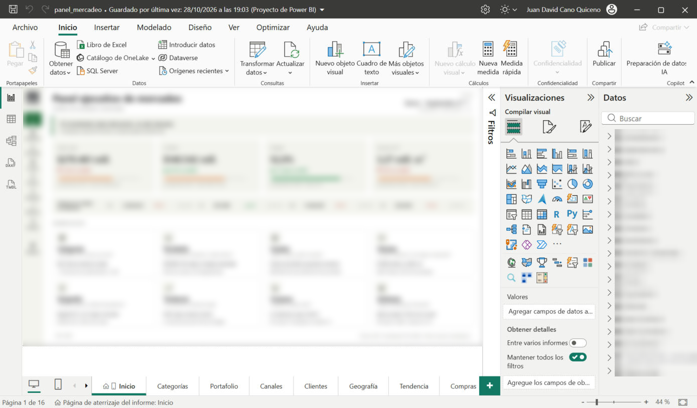
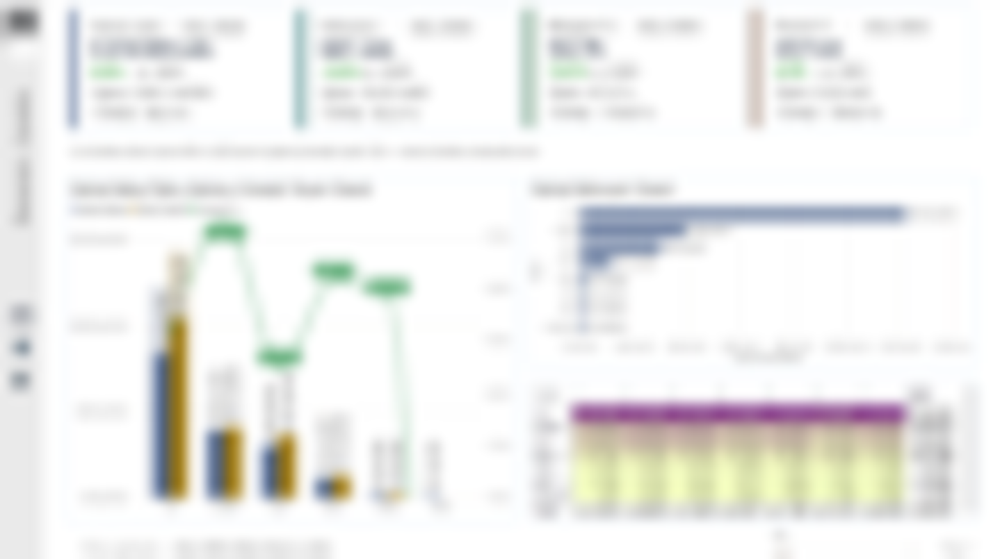
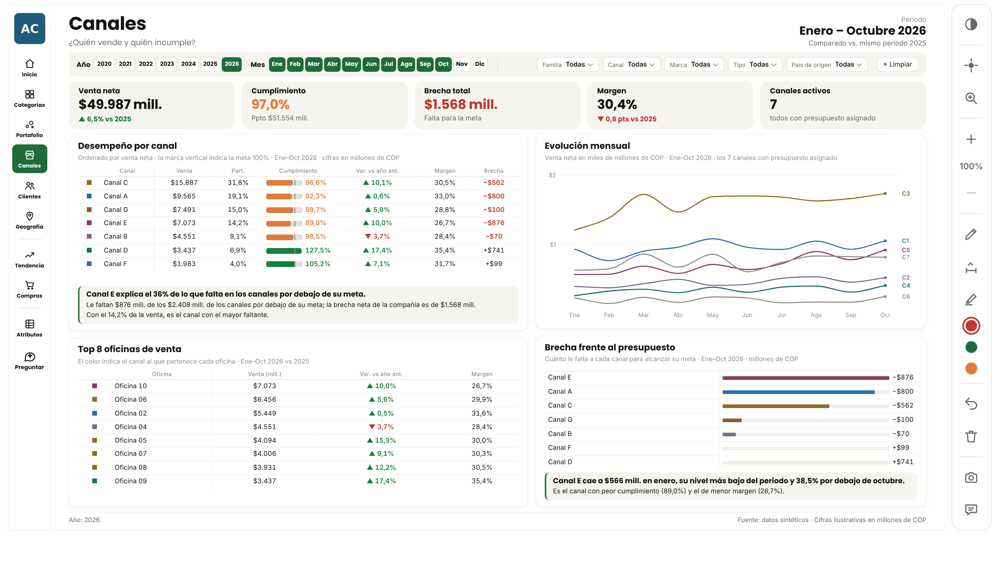

# 04 · Informe de Power BI

*Proyecto abierto en Power BI Desktop. El lienzo está desenfocado porque muestra cifras reales; las vistas legibles (con cifras ficticias) están en `imagenes/vistas/`.*

## Las 16 páginas

| # | Página | Pregunta que responde |
|---|---|---|
| 1 | Inicio | Resumen ejecutivo: titular, KPI con meta y una tarjeta por página con su hallazgo |
| 2 | Categorías | ¿Qué pasó con la venta y por qué? (efecto volumen vs. efecto precio) |
| 3 | Portafolio | ¿Qué productos sostienen y cuáles drenan? (crecimiento × margen) |
| 4 | Canales | ¿Quién vende y quién incumple? |
| 5 | Clientes | ¿A quién vendemos y nos siguen comprando? |
| 6 | Geografía | ¿Dónde crecemos y dónde retrocedemos? |
| 7 | Tendencia | ¿Es coyuntura o tendencia larga? |
| 8 | Compras | ¿Podemos sostener esto? (cobertura compra/venta) |
| 9–16 | Atributos | Familia, Categorías, Marcas y Formato, cada una en gráficos y en tabla |

## Formato PBIR

| Tipo de objeto | Cantidad |
|---|---|
| Cuadros de texto | 635 |
| Tarjetas | 391 |
| Imágenes | 338 |
| Formas | 328 |
| Segmentaciones | 107 |
| Tablas y matrices | 54 |
| Gráficos (líneas, columnas, árbol, dispersión) | 19 |
| Botones | 15 |
| Mapa | 1 |
| **Total** | **1.888** |

El proyecto se guarda como texto (PBIP/PBIR + TMDL): cada visual es un JSON y cada tabla un archivo `.tmdl`, lo que permite revisar cambios, generar visuales en lote y leer el modelo desde scripts.

## Sistema visual

- Lienzo de 1920 × 1080. Títulos en Poppins y texto en Segoe UI.
- Color semántico: positivo `#12823C`, negativo `#C0392B`, activo `#1F6B3A`; medidas: venta `#1F5C7A`, volumen `#7A6A8C`, precio `#8A6D1F`, rentabilidad `#2A6FB0`.
- Color fijo por nombre para líneas de producto, canales y segmentos (no depende del orden).
- Navegación lateral fija, barra de filtros con el tiempo a la izquierda y las segmentaciones a la derecha, pie con fuente y fecha de corte.
- Todo texto con cifras (titulares, subtítulos, notas, narrativas) es una medida DAX.

## Antes y después

| Antes (tablero original, desenfocado) | Después (cifras ficticias) |
|---|---|
|  |  |
